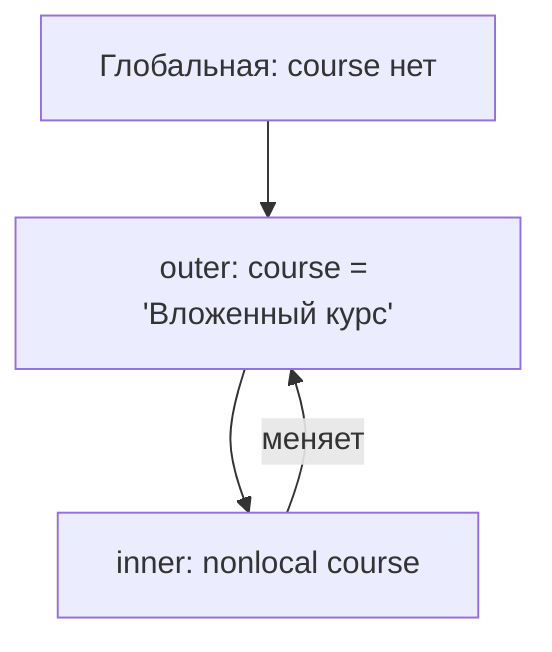

# ЗАДАНИЕ 1

### Таблица тестовых сценариев

| N | score | work_type | absences | Ожидаемый уровень | Ожидаемое пояснение | Фактический результат |
|---:|---:|---|---:|---|---|---|
| 1 | 0 | exam | 0 | недостаточный | экзаменационная работа | недостаточный / экзаменационная |
| 2 | 59 | practice | 0 | недостаточный | практическая работа | недостаточный / практическая |
| 3 | 60 | project | 0 | удовлетворительный | проектная работа | удовлетворительный / проектная |
| 4 | 74 | exam | 0 | удовлетворительный | экзаменационная работа | удовлетворительный / экзаменационная |
| 5 | 75 | exam | 4 | удовлетворительный (пониж.) | экзаменационная работа | удовлетворительный / экзаменационная |
| 6 | 89 | project | 0 | хороший | проектная работа | хороший / проектная |
| 7 | 90 | practice | 0 | отличный | практическая работа | отличный / практическая |
| 8 | 100 | exam | 3 | отличный (без понижения) | экзаменационная работа | отличный / экзаменационная |
| 9 | 95 | exam | 4 | хороший (понижение) | экзаменационная работа | хороший / экзаменационная |
| 10 | 45 | test | 0 | недостаточный | неизвестный тип работы | недостаточный / неизвестный тип |
| 11 | 105 | exam | 0 | ошибка диапазона | — | "Ошибка: результат или пропуски вне диапазона" |
| 12 | 80 | exam | 6 | ошибка диапазона | — | "Ошибка: результат или пропуски вне диапазона" |

### Объяснение порядка проверки условий

Сначала выполняется проверка диапазонов score (0,100) и absences (0,5).
Если хотя бы одно значение некорректно - выводится сообщение и программа
прекращает классификацию. Только после успешной валидации
идёт if/elif/else для score от высокого к низкому. Затем, если absences > 3, уровень понижается на одну ступень. В конце match/case формирует пояснение по
work_type.

### Недостижимые ветви при выбранном порядке

* При порядке "сверху вниз" (>=90 -> >=75 -> >=60) все ветви каскада
  достижимы: диапазоны не пересекаются.
* Если поменять порядок на обратный (первым >=60), то ветви >=75 и >=90
  станут недостижимыми — все значения >=60 попали бы в первую ветвь.
* Ветвь case _ достижима только потому, что work_type не проверяется
  в части 1 — это защитная ветвь.
* Понижение ниже "недостаточного" недостижимо из-за max(0, idx - 1).

# ЗАДАНИЕ 2

### Временная сложность и сложность по памяти

| Алгоритм | Время | Память | От чего зависит |
|---|---|---|---|
| Один проход по списку | O(n) | O(1) | длины списка |
| Второй проход (среднее) | O(n) | O(1) | длины списка |
| Линейный поиск | O(n) | O(1) | позиции элемента |
| Проверка простоты до sqrt(n) | O(sqrt(n)) | O(1) | величины числа |
| Сортировка выбором | O(n^2) | O(1) | n^2 сравнений |
| Бинарный поиск | O(log n) | O(1) | log2(n) сравнений |

### Почему ограничение делителей квадратным корнем корректно

Если n = a*b и a <= b, то a <= sqrt(n). Значит, у любого составного n
есть делитель, не превосходящий sqrt(n). Если до sqrt(n) включительно
делителей не найдено - число простое.

### Сравнительная таблица числа линейный и бинарный поиск

| Размер | Цель | Лин. сравн. | Бин. сравн. |
|-------:|-----:|------------:|------------:|
| 10     | 95   | 4           | 3           |
| 100    | 997  | 57          | 7           |
| 1000   | 10000| 634         | 10          |

# ЗАДАНИЕ 3

Оценка средней сложности добавления и поиска для использованных коллекций

| Операция | Структура | Средняя сложность |
|---|---|---|
| Добавление | set | O(1) |
| Проверка вхождения | set | O(1) |
| Добавление | dict | O(1) |
| Поиск по ключу | dict | O(1) |
| Добавление в конец | list | O(1) |
| Линейный поиск в list | list | O(n) |

Объяснения

- Множество подходит для хранения уникальных значений: оно автоматически
  убирает повторы и даёт O(1) в среднем на проверку вхождения,
  объединение и пересечение.
- Кортеж можно использовать как ключ словаря, потому что он неизменяем.
- Список нельзя использовать как ключ словаря: он изменяем, Python выбрасывает TypeError: unhashable type: 'list'.
- Словарь предпочтительнее списка для частого поиска результата по
  составному ключу (student, lab): словарь даёт O(1) в среднем,
  а список — O(n) на линейный поиск.

# ЗАДАНИЕ 4

Схема областей видимости LEGB

### Схема областей видимости LEGB

Значение по умолчанию [] создаётся один раз в момент определения
функции и хранится в объекте функции. При каждом вызове без аргумента
results используется один и тот же список, поэтому вызовы накапливают
элементы:

add_result(1)  -> [1]

add_result(2)  -> [1, 2]

### Какое значение сохраняется в замыкании

make_threshold_checker(threshold) возвращает функцию, замкнутую на
параметр threshold. Каждый вызов фабрики создаёт своё замыкание со
своим значением threshold: две проверки с threshold=60 и threshold=90
работают независимо, потому что каждая сохраняет собственное значение
в своей ячейке замыкания.

# ЗАДАНИЕ 5

### Контракты функций

mean(values)
  Вход: список чисел (возможно пустой).
  Результат: float — среднее арифметическое.
  Особый случай: пустой список -> 0.0 (правило выбрано заранее).

minimum(values)
  Вход: непустой список чисел.
  Результат: float — минимальное значение (без min()).
  Особый случай: пустой список -> ранний return None.

maximum(values)
  Вход: непустой список чисел.
  Результат: float — максимальное значение (без max()).
  Особый случай: пустой список -> ранний return None.

classify(score)
  Вход: число 0..100.
  Результат: строка категории ("отличный"/"хороший"/
  "удовлетворительный"/"недостаточный").
  Особые случаи: нет.

student_summary(name, results)
  Вход: имя (str), список результатов (list[int]).
  Результат: dict с ключами mean, min, max, category.
  Особый случай: пустой список -> category = "нет данных",
  mean/min/max = None или 0.0 (по выбранному правилу).

group_summary(students)
  Вход: dict[str, list[int]].
  Результат: dict со средним группы, числом студентов и счётчиками
  по категориям.
  Особый случай: пустая группа -> нулевые значения.

find_top_students(students)
  Вход: dict[str, list[int]].
  Результат: список студентов с наибольшим средним (может быть
  несколько).
  Особый случай: пустая группа -> [].

format_report(student_data, group_data)
  Вход: два словаря (результаты по студентам и общая статистика).
  Результат: строка итогового отчёта.
  Особые случаи: нет.

### Сценарии проверки

| N | Сценарий | Вход | Ожидание |
|---:|---|---|---|
| 1 | Обычный набор | исходный `students` | 4 студента, лидер — Дарья |
| 2 | Один студент | `{"A": [80]}` | лидер — A, среднее группы = 80 |
| 3 | Несколько лидеров | `{"A":[90],"B":[90]}` | лидеры: A и B |
| 4 | Пустая группа | `{}` | нули, лидеров нет |
| 5 | Студент без результатов | `{"A":[]}` | category «нет данных», не падает |
| 6 | Границы категорий | 59/60/74/75/89/90 | правильные категории |

Объяснение декомпозиции программы

Программа разбита на независимые функции по уровням:
- элементарные (mean, minimum, maximum, classify);
- уровень студента (student_summary);
- уровень группы (group_summary, find_top_students);
- форматирование (format_report).
Каждая функция отвечает за одну задачу и не изменяет входные данные.

Оценка сложности построения общей статистики

group_summary обходит всех студентов и все их результаты:
O(N*M), где N - число студентов, M - средняя длина списка результатов
(суммарно O(сумма |results|)). find_top_students делает один проход
по студентам: O(N).

