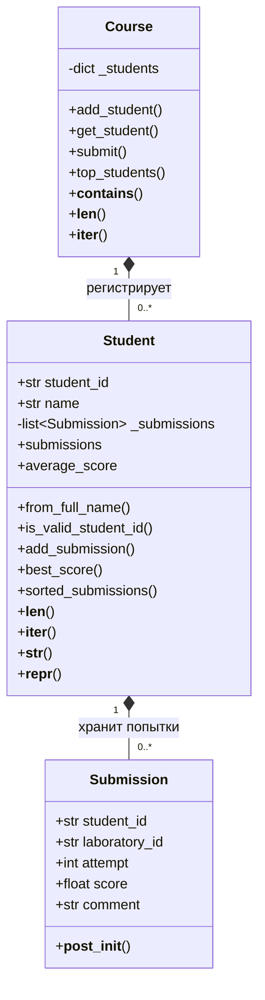

# Министерство науки и высшего образования Российской Федерации

## Национальный исследовательский университет ИТМО

**Факультет:** Прикладной информатики  
**Образовательная программа:** ТОП ИТ ПРО  
**Направление подготовки:** 09.03.03

<br>

# ЛАБОРАТОРНАЯ РАБОТА № 4

**По дисциплине:** «Основы программирования»  
**Тема:** «Итераторы, генераторы и объектная модель Python»

<br>

| | |
|---|---|
| Выполнил | Сафин Даниил Рустемович |
| Проверил | Летенков Илья Алексеевич |
| Дата | 24.11.2026 |

<br>

**Санкт-Петербург 2026**

---

# Цель работы

Изучить протокол итерации Python, научиться создавать собственные итераторы и генераторы, применять ленивые вычисления, включения коллекций, а также проектировать классы с использованием композиции, наследования и специальных методов Python Data Model.

# Ход работы

## Задание 1. Протокол итерации

Для выполнения задания создан файл `task_1.py`. В начале программы исследуется поведение списка и полученного из него итератора:

```python
values = [10, 20, 30]
iterator = iter(values)

print(iterator is values)
print(iter(iterator) is iterator)
print(next(iterator))
print(next(iterator))
print(next(iterator))
# print(next(iterator))
```

Первое сравнение выводит `False`, поскольку `iter(values)` создает отдельный объект-итератор. Второе сравнение выводит `True`: вызов `iter()` для уже существующего итератора возвращает этот же объект. Три вызова `next()` последовательно возвращают значения `10`, `20` и `30`. Четвертый вызов вызвал бы исключение `StopIteration`, поэтому он оставлен закомментированным.

Реализована функция `consume(iterable)`, которая вручную получает итератор с помощью `iter()`, извлекает элементы через `next()` и завершает работу при перехвате `StopIteration`. Цикл `for` и преобразование `list(iterable)` внутри функции не используются.

Проверка показала следующие результаты:

| Источник | Результат |
|---|---|
| `[1, 2, 3]` | `[1, 2, 3]` |
| `(4, 5, 6)` | `[4, 5, 6]` |
| `"abc"` | `['a', 'b', 'c']` |
| `range(3)` | `[0, 1, 2]` |
| Частично использованный итератор `[1, 2, 3, 4, 5]` после двух `next()` | `[3, 4, 5]` |

Повторный обход списка возвращает его элементы каждый раз, так как список является итерируемым контейнером и при вызове `iter()` создает новый итератор. Итератор хранит собственное состояние. После полного обхода он исчерпан, поэтому повторный обход того же объекта возвращает пустую последовательность.

Дополнительно реализованы `my_enumerate()` и `my_zip()`. Обе функции являются генераторами и работают с произвольными итерируемыми объектами. `my_enumerate()` выдает пары «индекс — элемент», а `my_zip()` объединяет элементы двух источников и прекращает работу при исчерпании самого короткого источника.

Примеры результатов:

```text
my_enumerate(["a", "b", "c"]) -> [(0, "a"), (1, "b"), (2, "c")]
my_enumerate("xy", start=1)   -> [(1, "x"), (2, "y")]
my_zip([1, 2, 3], "ab")       -> [(1, "a"), (2, "b")]
```

**Ответы на вопросы**

1. `iter()` должен вернуть итератор — объект, поддерживающий `__next__()`. Для контейнера обычно создается новый итератор.
2. После исчерпания данных `next()` должен возбуждать `StopIteration`.
3. Итератор возвращает сам себя из `iter()`, потому что он уже представляет текущий обход и хранит его состояние. Создание нового итератора при каждом вызове `iter(iterator)` нарушило бы ожидаемую семантику протокола.

## Задание 2. Собственный итератор

В файле `task_2.py` реализован класс `StepRange`, представляющий целочисленную последовательность с произвольным ненулевым шагом. Состояние обхода вынесено в отдельный класс `StepRangeIterator`.

Класс `StepRange` хранит только начальное значение, конечную границу и шаг. Метод `__iter__()` при каждом вызове создает новый `StepRangeIterator`. Итератор хранит текущее значение и самостоятельно проверяет условие завершения в `__next__()`.

Проверены положительный и отрицательный шаги, пустые диапазоны, нулевой шаг, повторный обход и независимость итераторов.

| Выражение | Результат |
|---|---|
| `list(StepRange(0, 5, 1))` | `[0, 1, 2, 3, 4]` |
| `list(StepRange(5, 0, -1))` | `[5, 4, 3, 2, 1]` |
| `list(StepRange(0, 0, 1))` | `[]` |
| `list(StepRange(0, 5, -1))` | `[]` |
| `StepRange(0, 5, 0)` | `ValueError` |

Реализованы дополнительные методы `__len__()`, `__contains__()` и `__repr__()`. Длина вычисляется арифметически, а не путем перебора элементов. Проверка принадлежности также выполняется без последовательного обхода: сначала проверяются границы диапазона, затем остаток от деления разности на шаг.

Для диапазона `StepRange(2, 11, 3)` получаются значения `[2, 5, 8]`. Проверка `8 in numbers` возвращает `True`, а `7 in numbers` — `False`.

**Состояние двух независимых итераторов**

Для наглядности созданы два итератора одного объекта `StepRange(2, 11, 3)`. Каждый из них начинает обход с начального значения.

| Шаг | Действие | Значение A | Текущее A | Значение B | Текущее B |
|---:|---|---:|---:|---:|---:|
| 0 | Создание | — | 2 | — | 2 |
| 1 | `next(A)`, `next(B)` | 2 | 5 | 2 | 5 |
| 2 | `next(A)`, `next(B)` | 5 | 8 | 5 | 8 |
| 3 | `next(A)`, `next(B)` | 8 | 11 | 8 | 11 |

Итераторы не влияют друг на друга, поскольку каждый хранит собственное текущее значение.

**Ответы на вопросы**

1. Состояние обхода хранится в отдельном объекте, чтобы один итерируемый диапазон можно было обходить несколько раз и одновременно использовать несколько независимых итераторов.
2. Если `__iter__()` будет возвращать один и тот же изменяемый итератор, независимые обходы будут делить состояние. Продвижение одного обхода повлияет на другой.
3. `StepRange` хранит фиксированное число целых значений независимо от длины последовательности. Дополнительная память самого диапазона составляет `O(1)`. Каждый отдельный итератор также занимает `O(1)` памяти.

## Задание 3. Генераторы и ленивый конвейер

В файле `task_3(1).py` реализованы генераторы `read_measurements()`, `filter_range()` и `moving_average()`. Они последовательно преобразуют непустые строки в вещественные числа, фильтруют значения по закрытому диапазону и вычисляют скользящее среднее.

Конвейер имеет вид:

```text
строки → числа → фильтрация диапазона → скользящее среднее
```

Промежуточные результаты не собираются в списки. Для хранения окна используется `deque` фиксированной максимальной длины. Поэтому память окна зависит от размера окна, а не от количества входных измерений.

Для исходных данных:

```python
raw_lines = ["10.0", "", "12.5", "100.0", "11.5", "13.0", "9.5"]
```

при фильтрации по диапазону от `9.0` до `20.0` и размере окна `2` получены результаты:

| Операция | Результат |
|---|---|
| Первое значение через `next()` | `11.25` |
| Второе значение через `next()` | `12.0` |
| Оставшиеся значения | `[12.25, 11.25]` |
| Повторный обход исчерпанного генератора | `[]` |
| Новый конвейер | `[11.25, 12.0, 12.25, 11.25]` |

Исходный список строк после обработки не изменился. При размере окна `0` возбуждается `ValueError`.

Дополнительно созданы списковое, множественное и словарное включения, а также генераторное выражение для суммы квадратов. Для миллиона квадратов размер списка составил около `8 448 728` байт, а размер генераторного выражения — около `200` байт в проведенном запуске. Эти значения зависят от версии Python и платформы, но демонстрируют различие подходов: список хранит все вычисленные элементы, генератор вычисляет очередной элемент по запросу.

Реализованы универсальные генераторы `take(n, iterable)`, `drop(n, iterable)` и `batch(iterable, size)`. Они не преобразуют весь источник в список. Для тестового источника `range(7)` функция `batch(..., 3)` сформировала `[[0, 1, 2], [3, 4, 5], [6]]`.

**Сравнение потребления памяти**

С помощью `tracemalloc` измерен пик памяти при обработке 100 000 чисел:

| Вариант | Результат вычисления | Пиковая память |
|---|---:|---:|
| Ленивый конвейер | `4 049 800.0` | `2.5 КБ` |
| Конвейер со списками на каждом этапе | `4 049 800.0` | `11 386.3 КБ` |

Результаты вычислений совпали. Ленивый вариант использовал существенно меньше памяти, поскольку не хранил одновременно исходные и промежуточные коллекции.

**Вывод по заданию**

Генераторное выражение и функции с `yield` позволяют обрабатывать данные по одному элементу. Это снижает пиковое потребление памяти и позволяет работать с большими или потенциально бесконечными последовательностями. Включения удобны, когда требуется сразу получить готовую коллекцию.

## Задание 4. Модель предметной области

В файле `task_4.py` реализована объектная модель системы сдачи лабораторных работ. Она состоит из классов `Submission`, `Student` и `Course`.

Класс `Submission` оформлен с помощью `dataclass`. Он хранит идентификатор студента, идентификатор лабораторной работы, номер попытки, балл и комментарий. Метод `__post_init__()` проверяет основные инварианты: идентификаторы не должны быть пустыми, номер попытки должен быть положительным, а балл должен находиться в диапазоне от 0 до 100. Автоматически созданный `dataclass` метод `__eq__()` сравнивает объекты по полям.

Класс `Student` хранит работы во внутреннем списке `_submissions`. Свойство `submissions` возвращает кортеж, поэтому внешний код не может изменить внутреннюю коллекцию. Свойство `average_score` вычисляет средний балл, `best_score()` — лучший результат по указанной лабораторной работе, а `sorted_submissions()` возвращает новый отсортированный список и не меняет порядок исходных данных.

Для создания студента предусмотрены альтернативный конструктор `from_full_name()` и статический метод `is_valid_student_id()`.

Класс `Course` хранит студентов в словаре по идентификатору. Он предоставляет методы регистрации, получения студента, создания сдачи и формирования списка лучших студентов. Специальные методы обеспечивают работу `len(course)`, оператора `in` и цикла `for`.

**Результаты демонстрации**

| Проверка | Фактический результат |
|---|---|
| Количество студентов в курсе | `3` |
| Количество попыток Ивана | `3` |
| Средний балл Ивана | `71.67` |
| Лучший балл Ивана по `lab1` | `85` |
| Лучший балл по отсутствующей `lab9` | `None` |
| `'s1' in course` | `True` |
| `'s9' in course` | `False` |
| Топ-2 студентов | Анна Смирнова, Иван Петров |
| Сравнение одинаковых `Submission` | `True` |
| Сравнение попыток с разными номерами | `False` |

Проверка свойства `submissions` показала, что оно возвращает `tuple`. Попытка вызвать `append()` завершилась `AttributeError`, что подтверждает невозможность изменить внутренний список через свойство.

Проверка инвариантов подтвердила, что пустой идентификатор, нулевой номер попытки и балл `101` отклоняются с помощью `ValueError`.

**Диаграмма классов**



В данной модели используется композиция: объект `Student` содержит набор принадлежащих ему объектов `Submission`, а `Course` хранит зарегистрированных студентов. Наследование между `Student` и `Submission` было бы некорректным: студент не является попыткой сдачи, а попытка сдачи не является студентом. Это разные сущности с разной ответственностью, связанные отношением владения.

**Ответы на вопросы анализа**

- `Submission` защищает корректность отдельной записи о сдаче.
- `Student` проверяет принадлежность добавляемой работы конкретному студенту и скрывает внутренний изменяемый список.
- `Course` не допускает повторную регистрацию одного идентификатора и связывает сдачу с зарегистрированным студентом.
- `len(student)` возвращает количество попыток, `iter(student)` позволяет перебирать работы, а `student_id in course` проверяет регистрацию по ключу словаря.
- Композиция отражает отношение «содержит» между объектами и позволяет не связывать сущности искусственным наследованием.

## Задание 5. Расширяемый журнал учебного курса

В файле `task_5.py` реализована система регистрации событий учебного курса. В исходном файле основные классы и методы уже присутствовали, однако часть публичных методов была оформлена без аннотаций типов и подробной документации. В подготовленной версии код дополнен типами, строками документации, перегрузками `__getitem__()` и проверкой типа добавляемого события. Также исправлен демонстрационный расчет статистики: список оценок формируется один раз и затем используется для вычисления количества, максимума, минимума и среднего.

Абстрактный класс `CourseEvent` задает общий интерфейс событий: свойство `student_id`, метод `describe()` и время создания `created_at`. От него наследуются:

- `SubmissionEvent` — событие сдачи лабораторной работы;
- `AttendanceEvent` — посещение или пропуск занятия;
- `CommentEvent` — текстовая обратная связь;
- `DeadlineEvent` — срок сдачи лабораторной работы, добавленный в практическом расширении.

Класс `CourseJournal` хранит события в порядке добавления. Реализованы методы `add()`, `events_for_student()`, `events_by_type()` и `summary()`, а также специальные методы `__len__()`, `__iter__()`, `__getitem__()`, `__str__()` и `__repr__()`. Метод `__getitem__()` поддерживает как целочисленный индекс, так и срез.

Функция `render_timeline()` вызывает `describe()` у каждого события и не проверяет конкретный тип события. Благодаря общему интерфейсу добавление нового класса события не требует изменения этой функции.

`ScoreView` является отдельным итерируемым объектом и лениво выдает только баллы из `SubmissionEvent`. `FilteredJournalView` также является повторно обходимым представлением: он выдает только те события, для которых переданный предикат возвращает `True`.

**Результаты демонстрационного сценария**

Созданы три студента и десять событий трех основных типов, включая две попытки сдачи одной лабораторной работы. Результаты:

| Проверка | Результат |
|---|---|
| Количество событий в журнале | `10` |
| Количество `AttendanceEvent` | `4` |
| Количество `SubmissionEvent` | `4` |
| Количество `CommentEvent` | `2` |
| Результаты `ScoreView` | `[60, 85, 95, 40]` |
| Количество оценок | `4` |
| Максимальная оценка | `95` |
| Минимальная оценка | `40` |
| Средняя оценка | `70.0` |
| Комментарии через `is_comment` | `2` |
| События студента `s2` через `lambda` | `4` |

Повторный обход объектов `ScoreView` и `FilteredJournalView` возвращает те же значения, поскольку при каждом вызове `iter()` создается новый генератор обхода журнала.

В практическом расширении добавлен `DeadlineEvent`. Функция `render_timeline()` продолжила формировать его описание без каких-либо изменений. Это демонстрирует расширяемость полиморфного интерфейса.

**Сравнение механизмов расширения**

| Механизм | Применение в работе | Назначение |
|---|---|---|
| Наследование | `SubmissionEvent`, `AttendanceEvent`, `CommentEvent`, `DeadlineEvent` наследуются от `CourseEvent` | Общий интерфейс и единая обработка разных событий |
| Композиция | `CourseJournal` хранит события; `SubmissionEvent` содержит объект `Submission` | Связь объектов без искусственного наследования |
| Протоколы Python | `CourseJournal`, `ScoreView`, `FilteredJournalView` реализуют `__iter__`, `__len__`, `__getitem__` или `__iter__` | Совместимость с `for`, `len()`, индексированием и срезами |

# Вывод

В ходе лабораторной работы изучен протокол итерации Python и реализованы собственные итерируемые объекты, итераторы и генераторы. Практически подтверждено, что контейнер и итератор имеют разную семантику повторного обхода, а отдельный объект состояния позволяет создавать независимые итераторы.

Реализован ленивый конвейер обработки измерений. Эксперимент с `tracemalloc` показал, что ленивый подход значительно уменьшает пиковое потребление памяти по сравнению с последовательным созданием промежуточных списков.

Создана объектная модель курса с использованием `dataclass`, композиции, свойств, альтернативного конструктора, статического метода и специальных методов. В заключительном задании реализован расширяемый журнал событий с абстрактным базовым классом, наследниками, полиморфной обработкой, пользовательскими итерируемыми представлениями и фильтрацией по предикату.

Таким образом, специальные методы Python Data Model связывают пользовательские классы со стандартными операциями языка. Благодаря им собственные объекты могут естественно работать с `for`, `next()`, `iter()`, `len()`, `in`, индексированием и срезами, сохраняя понятный интерфейс и контролируемое состояние.
